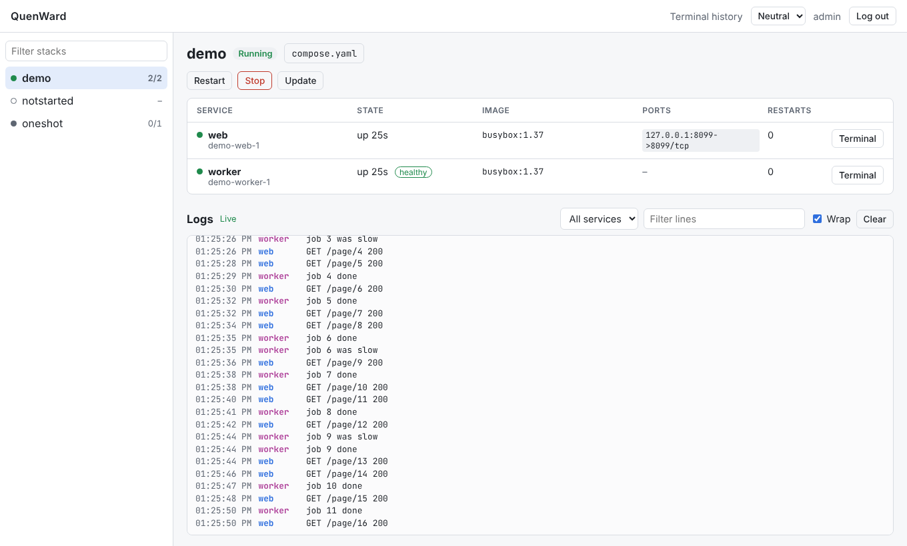
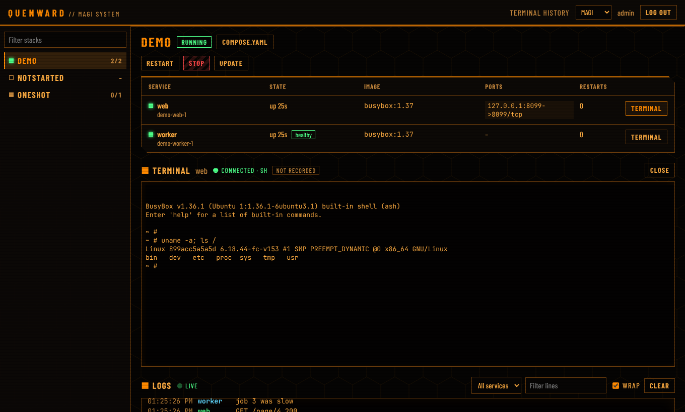

# QuenWard

**A web dashboard for the Docker Compose stacks on your home server.** See what's
running, read the logs, start, stop and update stacks, open a terminal in a
container and edit compose files, all from the browser, behind a proper login.

QuenWard is built for a homelab: one server, a handful of stacks in a folder,
used from your home network or VPN. It puts security first, because whoever
can use it controls the server.

| Neutral theme | MAGI theme |
| --- | --- |
|  |  |

> **Status:** 0.1, a first release. It works and is in daily use, but expect
> changes before 1.0.

## What it does

- **Every stack at a glance:** all the stacks in your stacks folder, running or
  not, with their containers, ports, health and restarts.
- **Live logs** from all services of a stack, colour-coded, with a filter.
- **Start, stop, restart and update** a stack with one click, with the output
  shown live. Update keeps the previous version of each image, in case an
  update breaks something and you need to
  [go back](docs/stacks.md#stack-actions).
- **A terminal** in any running container, right in the browser.
- **Edit compose files** with checks before saving, so a typo can't break a
  stack, and a backup of the previous version.
- **Two themes:** a neutral one that follows your light or dark mode, and MAGI,
  a NERV-style console.

## Before you start: is it safe?

QuenWard needs access to Docker on your server, and **access to Docker is the
same as full control of the server**. Anyone who can log in to QuenWard could
use it to read or change any file on the machine. That is why:

- **Only use it on your home network or over a VPN.** Never make it reachable
  from the internet: no port forwarding, no public tunnels.
- **Use a strong password.** QuenWard refuses short and common ones, and locks
  logins after repeated failures.
- **Serve it over HTTPS** once you've tried it out
  ([how](docs/https.md)). Browsers won't keep you logged in over plain HTTP
  except on the machine itself.

QuenWard itself is hardened: it runs as a normal user, not root, with a
read-only file system, and never sends passwords or secrets from your
containers to the browser. Every version is scanned for known vulnerabilities.
The details are in [SECURITY.md](SECURITY.md).

## Quick start

You need a Linux server (x86-64, or 64-bit ARM like a Raspberry Pi 4 or 5) with
Docker and the Docker Compose plugin. The steps below assume your stacks live
in `/home/you/docker`, one folder per stack. Replace that with your own path
everywhere.

**1. Make a folder for QuenWard next to your other stacks:**

```bash
mkdir -p /home/you/docker/quenward
cd /home/you/docker/quenward
```

**2. Tell it which group can use Docker on your server:**

```bash
echo "DOCKER_GID=$(stat -c %g /var/run/docker.sock)" > .env
```

**3. Create `compose.yaml` in that folder:**

```yaml
services:
  quenward:
    image: ghcr.io/tunnelpojken/quenward:0.1
    container_name: quenward
    restart: unless-stopped
    ports:
      - "127.0.0.1:5005:5005"   # only reachable from the server itself
    environment:
      STACKS_DIR: /home/you/docker
    group_add:
      - "${DOCKER_GID}"
    volumes:
      - data:/data
      - /var/run/docker.sock:/var/run/docker.sock
      # Your stacks folder, at the same path inside as outside.
      - /home/you/docker:/home/you/docker
    read_only: true
    tmpfs:
      - /tmp
    cap_drop:
      - ALL
    security_opt:
      - no-new-privileges:true
    mem_limit: 256m

volumes:
  data:
```

**4. Start it:**

```bash
docker compose up -d
```

**5. Open it.** On your own computer, connect to the server with an SSH tunnel
and open the address it gives you:

```bash
ssh -L 5005:127.0.0.1:5005 you@your-server
# then open http://127.0.0.1:5005 in your browser
```

**6. Create your admin account.** The first time, QuenWard asks for a one-time
setup code. It's printed in its log on the server:

```bash
docker logs quenward 2>&1 | grep "setup token"
```

Paste it in, choose a username and a password of at least 12 characters, and
log in. QuenWard shows up in its own list as "this app", read-only, so you
can't stop it from inside itself by accident.

## Next steps

- **Use it without the SSH tunnel:** put it behind HTTPS on your network. The
  [HTTPS guide](docs/https.md) has a complete, working example with Caddy and a
  free Let's Encrypt certificate.
- **Let it edit your compose files:** QuenWard can show every file right away,
  but needs your permission to change them.
  [Compose editor](docs/compose-editor.md) explains the one-time command.
- **Get a phone notification** on failed logins and password resets, with
  ntfy. See [Configuration](docs/configuration.md).
- **Record terminal sessions** (off by default, encrypted). See
  [Terminal](docs/terminal.md).

## Everyday questions

**I forgot my password.** There's deliberately no "forgot password" link. On
the server, run `docker exec -it quenward reset-password`. It prints a link
that works once, for 15 minutes.

**How do I update QuenWard?** It can't update itself (that would cut you off
halfway). On the server, in its folder:
`docker compose pull && docker compose up -d`. Your account and settings are
kept.

**Why does a stack say "partial"?** Some of its containers are running and
some aren't. Open it to see which.

**Can I use it from my phone?** Yes, the dashboard works on small screens. You
still need to be on your home network or VPN.

## Documentation

| Page | What's in it |
| --- | --- |
| [HTTPS](docs/https.md) | Serving QuenWard over HTTPS with Caddy, or behind your own reverse proxy |
| [Stacks and updates](docs/stacks.md) | How stacks are found, what start, stop and update do, rollback, private registries |
| [Terminal](docs/terminal.md) | Limits, how sessions end, encrypted recordings |
| [Compose editor](docs/compose-editor.md) | How saving is checked, and giving QuenWard write access |
| [Configuration](docs/configuration.md) | All settings, phone alerts, themes, password reset, first start |
| [Development](docs/development.md) | Running it from source, tests, releases |
| [SECURITY.md](SECURITY.md) | What QuenWard protects against, how it's tested, and how to report a problem |

## License

[MIT](LICENSE)
